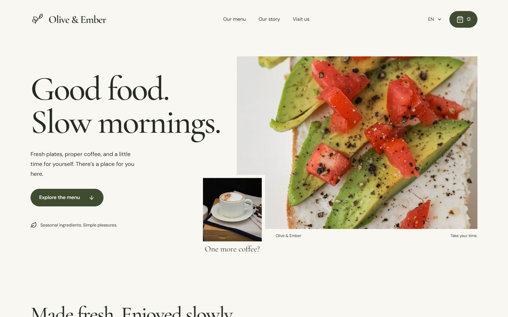
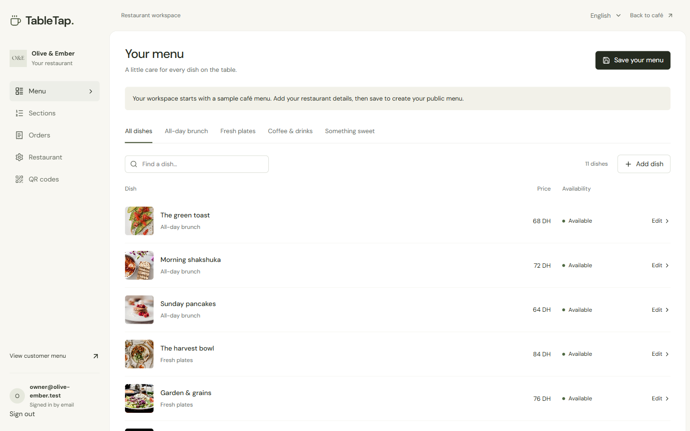
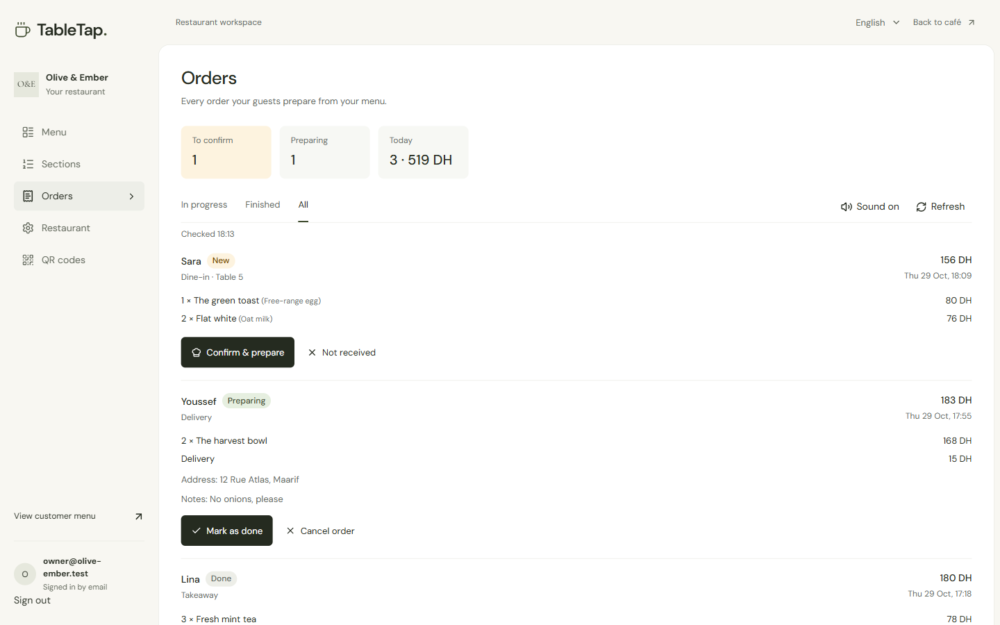
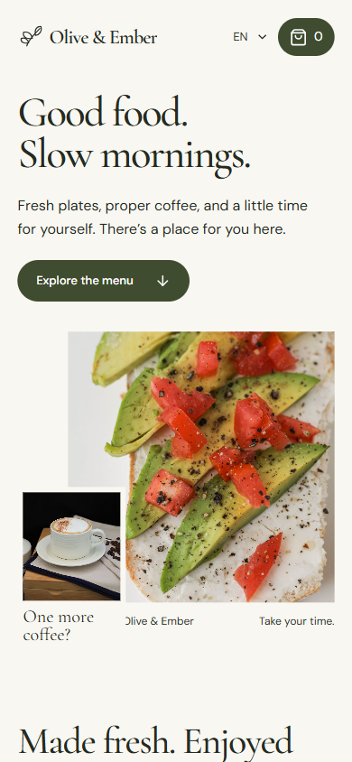
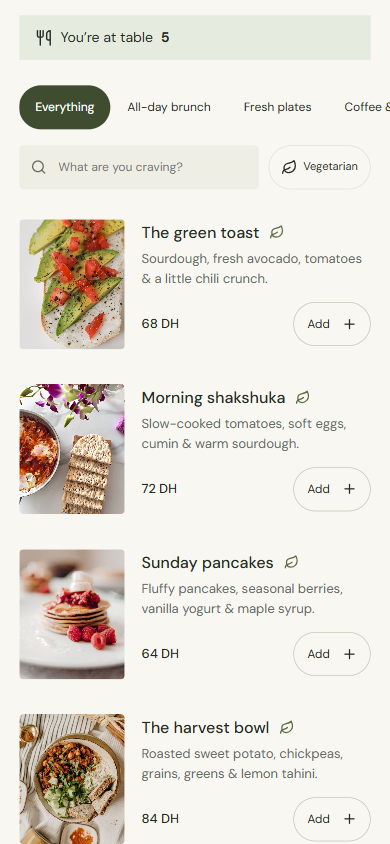
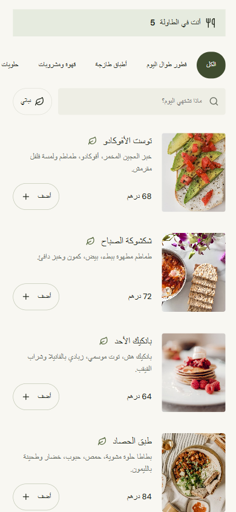

# TableTap

A café menu and ordering app with table QR codes, a persistent owner dashboard, and WhatsApp checkout. Built around **Olive & Ember**, a fictional café, with a complete English, French, and Arabic menu.

**[Try the live demo →](https://iliasjf.github.io/tabletap/)** Sign in to the owner dashboard with any email; the demo shows your code on screen.



| Owner dashboard | Orders |
| --- | --- |
|  |  |

| Phone | Menu | Arabic (right to left) |
| --- | --- | --- |
|  |  |  |

## Try it locally

Requires **Node.js 24+** and npm. No API key is needed for the local preview.

```sh
npm ci
npm run preview:local
```

Open **http://127.0.0.1:5173**. On Windows, you can also double-click `Start-TableTap.cmd`.

- `/` — café homepage and menu
- `/menu` — direct menu for QR scanning
- `/admin` — menu editor, menu sections, orders, restaurant details, and QR codes
- `/qr` — try the QR card generator without signing in
- `/credits` — photography and font credits
- `/privacy` — what TableTap keeps, why, and for how long

The local preview includes SQLite persistence. Owners sign in on `/admin` with their email and a 6-digit code. Locally, unless `RESEND_API_KEY` and `EMAIL_FROM` are set, the code is shown on screen and printed in the terminal instead of being emailed. The preview is deliberately bound to loopback and must never be exposed as a public production server. Hosted production uses Cloudflare D1.

## What works

- Responsive café homepage with locally stored food photographs and fonts.
- Menu search, owner-defined menu sections, a vegetarian filter, and unavailable dishes.
- Item extras, quantities, editable cart, and exact integer-based totals, written the way Moroccan menus do (“68 DH”, “68,50 DH”, “68 درهم”).
- A cart saved per restaurant in browser storage, validated against current menu data.
- Dine-in, takeaway, and delivery details, including table numbers and delivery fees.
- A formatted WhatsApp order preview, copy action, and encoded checkout link.
- English, French, and Arabic menu/checkout UI with right-to-left layout. Owners can fill in only the languages they want; missing translations fall back to the next available one.
- The owner dashboard in English, French or Arabic (right to left), following the phone's language on first visit.
- Owner menu editing: translations, prices, extras, availability, and restaurant details.
- Photo upload from a phone or computer, resized in the browser and stored with the menu.
- Menu sections the owner can add, rename in three languages, reorder, and remove.
- An order log: each order a customer opens in WhatsApp is recorded, priced from the saved menu, with today's count and value.
- Server-side validation, authenticated ownership, bounded request bodies, and optimistic revision checks.
- Passwordless email sign-in: a 6-digit code (10-minute expiry, 5 tries, 1-minute resend wait), hashed codes and session tokens, and 30-day HttpOnly sessions.
- Order statuses (new, preparing, done, cancelled) with an Orders screen that checks every 30 seconds and when you return to the tab. New orders play a short chime (can be switched off), show a banner, and count in the tab title. On phones the orders come first.
- Customers' names are remembered on their own phone for the next order.
- Link previews (Open Graph) so a shared menu link shows the café's name, tagline and a dish photo on WhatsApp and Instagram.
- Light pages: Latin-only WOFF2 fonts (130 KB for both) and compressed photos (500 KB for the sample menu).
- Spam limits: 20 orders per connection every 10 minutes, 10 sign-in codes per email per day, and caps on sign-in requests and guesses per connection. Only hashed IP addresses are stored, for at most a day.
- A privacy page (`/privacy`, in English, French and Arabic) and a note at checkout explaining what is kept.
- A readable menu link for each restaurant (`/menu?shop=olive-and-ember`), with optional `table=5` preselection. Links printed with the owner ID keep working.
- Downloadable QR SVGs and a print layout for table cards.

**WhatsApp is intentionally blank in the sample settings.** Set your own business number under **Owner dashboard → Restaurant**, include its country code, and save. The app opens WhatsApp with the message prepared; customers still press Send, and the restaurant confirms availability, totals, and preparation time. Orders are not automatically accepted, paid, or tracked by TableTap.

## Make it your restaurant

1. Open `/admin` and sign in with your email.
2. Change the restaurant name, story, address, hours, and WhatsApp number.
3. Edit dishes in English, French, and Arabic. Prices are shown in MAD.
4. Save the menu. The dashboard provides your restaurant's customer link.
5. Set your deployed website origin before generating customer QR cards. A loopback QR only works on the same computer.
6. For real customers, confirm your hosted site's audience permits customer access. The Site created for this work remains private and unpublished.

The sample content lives in `lib/menu-data.ts`. Prices use integer minor units: `6800` means **68 MAD**. Photos and license records are in `public/` and `docs/ASSETS.md`. Custom dish text and restaurant fields are entered by the owner; those fields are not machine-translated.

## Architecture

| Layer | Implementation |
| --- | --- |
| Interface | React 19, TypeScript, CSS, Lucide icons |
| Hosted framework | Vinext with App Router conventions |
| Hosted storage | Cloudflare D1 with Drizzle schema and migrations |
| Hosted identity | Email sign-in codes sent with Resend, sessions in D1 |
| Local preview | Rolldown browser build + loopback Node HTTP adapter + SQLite |
| QR generation | `qrcode`, generated locally in the browser |
| Orders | Browser cart → encoded WhatsApp message, plus a server-priced order log |

`lib/cart.ts` owns cart and order calculations. `lib/auth.ts` owns the sign-in rules, shared by production (`lib/auth-store.ts`, D1) and the local preview (SQLite). `lib/catalog-validation.ts` validates menu documents. Production route handlers under `app/api/` select database ownership from authenticated server identity, never from a client-supplied owner field. Public restaurant links are read-only. Revision comparisons reject stale updates rather than silently overwriting changes from another tab.

The local adapter reuses the same validation, sign-in rules and sample data, and follows the same API contract.

## Checks

```sh
npm run typecheck
npm test
npm run build:preview
```

The test suite covers totals and extras, cart tampering, unavailable items, multilingual URL encoding, order validation, owner selection, origin checks, malformed/oversized writes, SQLite persistence, and stale revision conflicts. GitHub Actions (`.github/workflows/ci.yml`) runs these checks, plus the preview build, on Node 24 for every push and pull request.

The local preview build, type check, and automated tests (32 at the latest update) were verified during development. Browser checks covered desktop/mobile layouts, Arabic RTL, customized checkout, delivery totals, owner sign-in, saved menus, and table-specific QR generation. See `docs/VERIFICATION.md` for the exact limits.

## Production deployment

The production app targets **Cloudflare Workers through Sites**, not a generic static or Vercel deployment.

- `.openai/hosting.json` declares `DB` as the D1 binding.
- `db/schema.ts` declares the catalog, photo, order, user, sign-in code and session tables.
- `drizzle/` contains the generated schema migration and metadata.
- `npm run db:generate` generates future migrations.
- `npm run build` builds the production Worker through the retained starter integration.
- Use the Sites source/publishing workflow to provision bindings, apply migrations, and deploy a saved version.

### Email sign-in setup (Resend)

1. Create a free account at [resend.com](https://resend.com) and verify your sending domain (Resend shows the DNS records to add).
2. Create an API key with **Sending access** only.
3. Add two values to the Worker's environment. Keep the key a **secret**; never commit it:
   - `RESEND_API_KEY`: the key from step 2.
   - `EMAIL_FROM`: a sender on your verified domain, such as `TableTap <login@your-domain.com>`.
4. Apply the migrations in `drizzle/` before deploying.

Without both values, the production sign-in form explains that email sign-in isn't set up, and no code is created. Owners who saved a menu under the earlier ChatGPT sign-in keep it if they first sign in by email, with the same address, while that ChatGPT session is still active.
- Use your own Site identity when cloning the project into a separate hosted Site. Never reuse another owner's project ID.

**No production deployment was completed in this session.** The Windows sandbox blocked the full Worker toolchain's subprocess pipes, and automatic approval review blocked passing source-publishing credentials to the helper. The expected Site address is not a live demo. The successfully tested local preview is independent of these publishing tools.

Owner identity comes only from the session cookie, never from client-supplied headers or fields. Codes and session tokens are stored as SHA-256 hashes.

## Live demo (GitHub Pages)

**https://iliasjf.github.io/tabletap/** runs the real interface as static files. A small in-browser API (`scripts/demo/demo-api.ts`) stands in for the server: it reuses the app's own validation, sign-in, order and pricing code, and keeps everything in the visitor's `localStorage`. Each visitor gets a private sandbox, sign-in codes appear on screen, new owners start with three sample orders, and **Reset demo** clears it all. Nothing is sent to a server, and customers can't reach a real restaurant on WhatsApp because the demo has no number set.

```sh
npm run build:demo   # builds demo-dist/ for /tabletap/
npm run serve:demo   # serves it at http://localhost:5174/tabletap/
```

To publish an update, push the contents of `demo-dist/` to the `gh-pages` branch; GitHub Pages serves that branch.

## License

Code is MIT licensed. Photography, fonts, icons, and retained starter/vendor code keep their respective licenses. See `docs/ASSETS.md` and font license files in `public/fonts/`.
